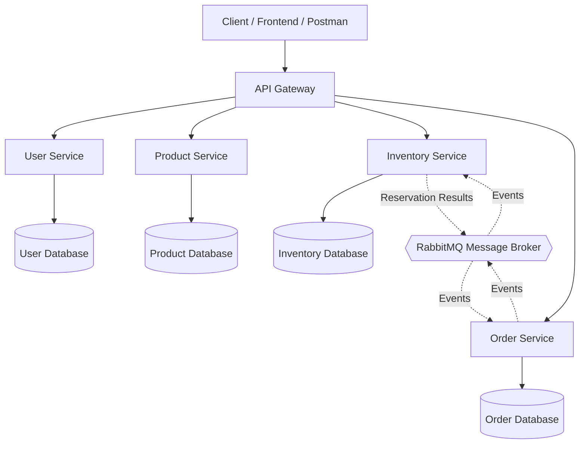
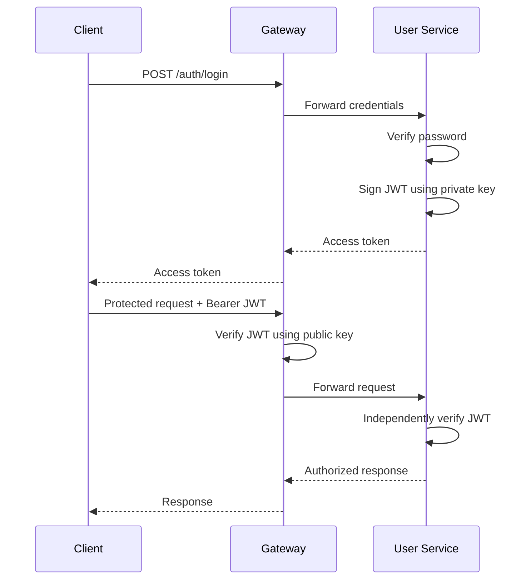
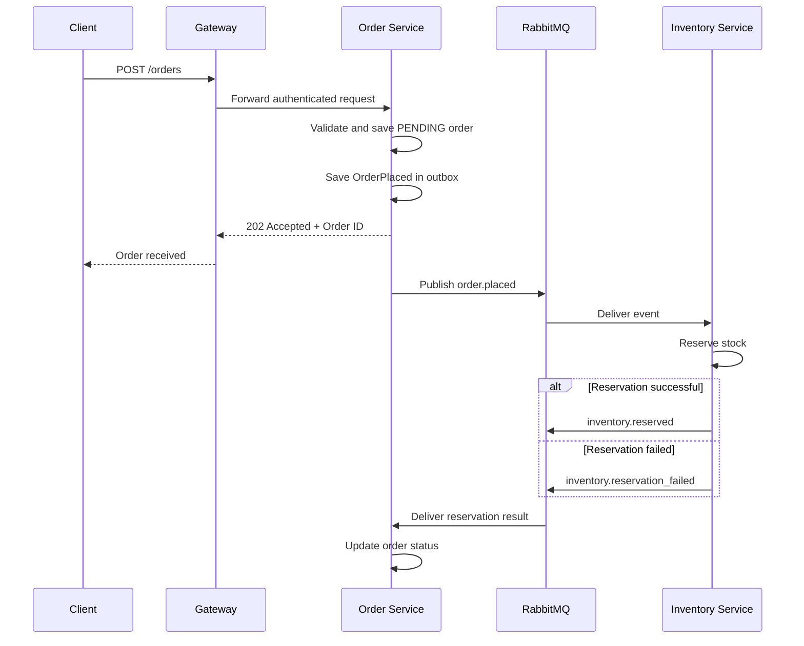

# Fast Store

### A Microservices-Based E-Commerce Platform Built with FastAPI

**Fast Store** is a backend engineering project focused on designing and building a scalable, modular, and event-driven e-commerce platform using Python, FastAPI, PostgreSQL, Docker, and RabbitMQ.

The project explores modern backend architecture and distributed system concepts through independently deployable services, centralized API access, secure authentication, asynchronous communication, and reliable event processing.

Rather than building a traditional monolithic e-commerce application, Fast Store is being developed as a collection of specialized services, each responsible for a clearly defined business domain.

The long-term objective is to build a complete order-processing ecosystem that can handle asynchronous workflows, inventory reservations, payment processing, and inter-service communication while maintaining service independence and data consistency.

---

## Table of Contents

- [Project Overview](#project-overview)
- [Architecture](#architecture)
- [Current Implementation](#current-implementation)
- [Technology Stack](#technology-stack)
- [Services](#services)
- [Authentication and Security](#authentication-and-security)
- [Event-Driven Architecture](#event-driven-architecture)
- [Order Processing Workflow](#order-processing-workflow)
- [Database Architecture](#database-architecture)
- [Project Structure](#project-structure)
- [Running the Project](#running-the-project)
- [Development Roadmap](#development-roadmap)
- [Engineering Principles](#engineering-principles)

---

## Project Overview

Fast Store is designed around a microservices architecture in which individual services own specific business capabilities and communicate through well-defined interfaces.

The platform currently includes:

- A centralized API Gateway.
- User management and authentication.
- Product service foundation.
- PostgreSQL integration.
- Docker-based service deployment.
- JWT-based authentication using RSA asymmetric cryptography.
- Inter-service HTTP communication.

The next development phase focuses on introducing Inventory and Order Services, followed by RabbitMQ-powered asynchronous messaging.

The architecture is intended to evolve toward an event-driven system in which services react to business events rather than relying exclusively on synchronous HTTP communication.

## Architecture

### High-Level Architecture



*Note: The diagram represents the target architecture. Inventory Service, Order Service, and RabbitMQ integration are planned development work, not completed components.*

### Architectural Approach

Each service is responsible for its own business logic and data.

The API Gateway provides a single entry point for external clients. It handles request routing and an initial authentication layer.

Internal services remain independently responsible for validating security-sensitive requests and enforcing their own business rules.

The architecture follows several important principles:

- Independent service responsibilities.
- Database ownership by individual services.
- Centralized external API access.
- Asynchronous communication for long-running workflows.
- Secure service-to-service communication.
- Eventual consistency where appropriate.
- Fault isolation and independent deployment.

---

## Current Implementation

The following functionality has been implemented and tested.

### 1. API Gateway

The API Gateway acts as the central entry point for the platform.

Implemented capabilities:

- Request routing to backend services.
- HTTP communication with downstream services using HTTPX.
- Shared asynchronous HTTP client.
- Centralized JWT authentication.
- Public and protected route handling.
- Request and response logging.
- Docker-based deployment.
- Backend connection error handling.

The Gateway forwards requests to the appropriate service using Docker's internal service networking.

### 2. User Service

The User Service handles user registration, authentication, and user-related operations.

Implemented capabilities:

- User registration.
- User login.
- Password hashing using Argon2.
- Password verification.
- JWT access token generation.
- RS256 asymmetric signing.
- Token expiration.
- Token issuer and audience validation.
- Protected user endpoints.
- Current-user retrieval.
- User profile access with ownership checks.
- PostgreSQL integration.
- SQLAlchemy ORM and Alembic migrations.

### 3. Product Service

The Product Service is an independently deployed service responsible for the product domain.

The service is included in the Docker-based application environment and is accessible through the API Gateway.

Its further development will include product catalog management and integration with inventory and order processing.

### 4. Docker Infrastructure

The current application environment uses Docker Compose.

Implemented infrastructure includes:

- PostgreSQL container.
- User Service container.
- Product Service container.
- API Gateway container.
- Persistent PostgreSQL storage.
- Container-to-container communication.
- Service startup dependencies.
- Health checking for PostgreSQL.

---

## Technology Stack

| Category | Technology |
|---|---|
| Language | Python 3.13 |
| Backend Framework | FastAPI |
| API Gateway | FastAPI |
| Database | PostgreSQL |
| ORM | SQLAlchemy 2.x |
| Database Migrations | Alembic |
| Validation | Pydantic |
| HTTP Client | HTTPX |
| Authentication | JWT |
| Cryptography | PyJWT / RS256 |
| Password Hashing | Argon2 via pwdlib |
| Dependency Management | uv |
| Containerization | Docker |
| Orchestration | Docker Compose |
| Message Broker | RabbitMQ (planned) |
| Async Messaging | aio-pika (planned) |

---

## Services

### API Gateway

**Responsibility:** External API access, request routing, and initial authentication.

The Gateway exposes backend functionality through a unified API interface.

It verifies access tokens before forwarding protected requests and handles public endpoints such as registration and login.

### User Service

**Responsibility:** User identity and authentication.

The User Service is the source of truth for user information and credentials.

It generates access tokens using a private RSA key. Other services use the corresponding public key to verify those tokens.

### Product Service

**Responsibility:** Product catalog and product information.

This service will own product information, including product names, descriptions, and pricing.

Inventory quantities will belong to the Inventory Service rather than being managed as part of the product catalog.

### Inventory Service — Planned

**Responsibility:** Stock management and inventory reservations.

The Inventory Service will own stock quantities and reservation operations.

Planned capabilities:

- Inventory creation and updates.
- Stock availability checks.
- Stock reservation.
- Stock release.
- Prevention of overselling.
- Concurrent reservation handling.
- Event publishing and consumption.
- Idempotent event processing.

### Order Service — Planned

**Responsibility:** Order lifecycle management.

The Order Service will handle customer orders and coordinate the order-processing workflow.

Planned capabilities:

- Order creation.
- Order item management.
- Product and price validation.
- Order status management.
- Asynchronous inventory reservation.
- Order cancellation.
- Inventory release on cancellation.
- Payment workflow integration.
- Event publishing and consumption.

---

## Authentication and Security

Fast Store uses JWT-based authentication with RSA asymmetric cryptography.

### RS256 Authentication Flow

The User Service generates access tokens using an RSA private key.

The API Gateway and other authorized backend services verify tokens using the corresponding RSA public key.



### Implemented Security Measures

- RS256 asymmetric signing.
- Private key restricted to the User Service.
- Public key used for token verification.
- Argon2 password hashing.
- Token expiration validation.
- Issuer validation.
- Audience validation.
- Token type validation.
- Protected API endpoints.
- User ownership checks.
- Secrets excluded from version control and Docker build context.
- Read-only key mounts in Docker.

### Security Direction

Future development will introduce role-based access control, including administrative permissions for product and inventory management.

Backend services will independently enforce authorization rather than relying exclusively on the API Gateway.

---

## Event-Driven Architecture — Planned

One of the major architectural goals of Fast Store is to introduce asynchronous communication using RabbitMQ.

In a traditional synchronous workflow, an Order Service might have to wait for the Inventory Service to check and reserve stock before responding to the customer.

Fast Store aims to avoid that unnecessary waiting time.

With event-driven communication, the Order Service can accept an order, persist it, and publish an event for asynchronous processing.

### Planned Messaging Architecture

RabbitMQ will act as the message broker between services.

The initial design will use:

- Topic exchanges.
- Durable queues.
- Routing keys.
- Persistent messages.
- Message acknowledgements.
- Retry mechanisms.
- Dead-letter queues.
- Idempotent consumers.

The messaging layer will be implemented using `aio-pika`.

### Initial Event Types

| Event | Description |
|---|---|
| `order.placed` | A customer places an order |
| `inventory.reserved` | Stock has been successfully reserved |
| `inventory.reservation_failed` | Stock reservation could not be completed |
| `inventory.released` | Previously reserved stock has been released |
| `order.confirmed` | An order has passed the required processing steps |
| `order.cancelled` | An order has been cancelled |
| `payment.completed` | Payment has been successfully processed |
| `payment.failed` | Payment processing has failed |

These event names and contracts will be refined as the services are implemented.

---

## Order Processing Workflow — Planned

The intended order workflow is asynchronous.



The customer receives an order ID without waiting for the inventory operation to finish.

The customer can retrieve the latest order status through the Order Service.

### Planned Order Lifecycle

```text
PENDING_INVENTORY
       |
       +----> INVENTORY_RESERVED
       |              |
       |              v
       |       PENDING_PAYMENT
       |              |
       |              v
       |         CONFIRMED
       |
       +----> INVENTORY_REJECTED
                      |
                      v
                   REJECTED
```

Additional states such as `PROCESSING`, `SHIPPED`, `DELIVERED`, and `CANCELLED` will be introduced as the order lifecycle expands.

### Reliability and Data Consistency

Asynchronous messaging introduces distributed system challenges.

To address these, the project will implement:

**Transactional Outbox Pattern**

The order and its corresponding event will be persisted within the same database transaction. A separate publisher will deliver unpublished events to RabbitMQ.

This prevents an order from being saved without a corresponding event being recorded.

**Idempotent Consumers**

Consumers will track processed event identifiers to prevent duplicate message delivery from causing duplicate business operations.

**Acknowledgements and Retries**

Messages will be acknowledged after successful processing. Temporary failures will use controlled retry mechanisms.

**Dead-Letter Queues**

Messages that repeatedly fail processing will be isolated for investigation instead of being retried indefinitely.

**Inventory Concurrency Protection**

Stock reservations will use database-level concurrency control to prevent multiple orders from reserving the same available stock.

The system will use eventual consistency between services rather than attempting to maintain one global database transaction.

---

## Database Architecture

Fast Store follows the database-per-service principle.

Each service owns its data and accesses it through its own application logic.

Planned database organization:

| Service | Database |
|---|---|
| User Service | `user_db` |
| Product Service | `product_db` |
| Inventory Service | `inventory_db` |
| Order Service | `order_db` |

PostgreSQL is used as the database engine.

Although multiple logical databases may run on the same PostgreSQL server during development, services will not directly access one another's database tables.

This keeps business ownership clear and reduces coupling between services.

---

## Project Structure

The repository uses a `uv` workspace to organize multiple Python services in a single monorepo.

```text
fast-store/
│
├── services/
│   ├── user-service/
│   │   ├── src/
│   │   │   └── user_service/
│   │   ├── Dockerfile
│   │   └── pyproject.toml
│   │
│   └── product-service/
│       ├── src/
│       │   └── product_service/
│       ├── Dockerfile
│       └── pyproject.toml
│
├── gateway/
│   └── api-gateway/
│       ├── src/
│       │   └── api_gateway/
│       ├── Dockerfile
│       └── pyproject.toml
│
├── docker/
│   └── postgres/
│       └── init/
│
├── secrets/
│   ├── private_key.pem
│   └── public_key.pem
│
├── docker-compose.yml
├── pyproject.toml
├── uv.lock
├── .dockerignore
├── .gitignore
└── README.md
```

The Inventory and Order Service directories will be added as those services are developed.

---

## Running the Project

### Prerequisites

Install the following:

- Python 3.13 or later.
- uv.
- Docker Desktop.
- Git.

### 1. Clone the repository

```bash
git clone https://github.com/mahdiandrovo/fast-store.git

cd fast-store
```

### 2. Configure environment variables

Create a local `.env` file containing the PostgreSQL credentials required by Docker Compose.

Example:

```env
POSTGRES_USER=faststore
POSTGRES_PASSWORD=change_this_password
```

Use your own secure credentials.

The `.env` file must remain outside version control.

### 3. Configure JWT keys

The User Service requires an RSA private/public key pair.

The private key must be available only to the User Service.

The public key must be available to services that verify access tokens.

The keys are expected at:

```text
secrets/private_key.pem
secrets/public_key.pem
```

Never commit private keys or production secrets to Git.

### 4. Start the Docker environment

```bash
docker compose up -d --build
```

### 5. Check running containers

```bash
docker compose ps
```

### 6. View service logs

```bash
docker compose logs -f api-gateway
```

To inspect all services:

```bash
docker compose logs -f
```

### 7. Stop the environment

```bash
docker compose down
```

To also remove the PostgreSQL persistent volume, use:

```bash
docker compose down -v
```

**Warning:** The `-v` option deletes the database volume and its stored data.

### Local Development

Individual services can also be run locally using the workspace.

For example, to run the API Gateway:

```bash
uv run --package api-gateway uvicorn api_gateway.main:app --reload --port 8010
```

---

## Development Roadmap

Fast Store is actively being developed. The roadmap below distinguishes completed work from planned capabilities.

| Phase | Scope | Status |
|---|---|---|
| 1 | Monorepo and workspace setup | Completed |
| 2 | PostgreSQL and Docker infrastructure | Completed |
| 3 | User Service implementation | Completed |
| 4 | JWT authentication and authorization foundations | Completed |
| 5 | API Gateway and request logging | Completed |
| 6 | RabbitMQ infrastructure | Planned |
| 7 | Inventory Service | Planned |
| 8 | Order Service | Planned |
| 9 | Transactional Outbox and reliable messaging | Planned |
| 10 | Payment workflow and Saga orchestration | Planned |
| 11 | Automated testing and observability | Planned |
| 12 | Performance and deployment improvements | Planned |

### Future Enhancements

Beyond the initial roadmap, the project may explore:

- Redis caching.
- Distributed tracing with OpenTelemetry.
- Metrics and monitoring with Prometheus and Grafana.
- CI/CD automation.
- Kubernetes deployment.
- API rate limiting.
- Advanced authorization policies.
- Event schema versioning.
- Load and resilience testing.

These are future exploration areas, not current capabilities.

---

## Engineering Principles

The project is being developed with a focus on practical backend engineering principles:

**Separation of Concerns**

Each service owns a distinct business domain and avoids unnecessary coupling.

**Independent Data Ownership**

Services manage their own databases and business data.

**Security by Design**

Authentication, authorization, password hashing, and secret management are treated as core architectural concerns.

**Asynchronous Processing**

Long-running workflows should not unnecessarily block client-facing API requests.

**Reliability**

Message delivery, duplicate processing, retries, and data consistency must be considered as part of the architecture.

**Containerization**

Services should be independently buildable and deployable using Docker.

**Maintainability**

The codebase should remain modular, readable, testable, and easy to extend.

---

## Project Status

Fast Store is an ongoing engineering project.

The foundation is in place: the User Service, Product Service foundation, API Gateway, PostgreSQL infrastructure, Docker environment, and JWT authentication are implemented.

The next major milestone is the introduction of RabbitMQ, Inventory Service, and Order Service to establish the platform's event-driven order-processing workflow.

The goal is not simply to make the application work, but to understand and implement the architectural decisions that make distributed backend systems reliable, scalable, and maintainable.

---

**Built with Python, FastAPI, PostgreSQL, Docker, and a focus on modern backend engineering.**